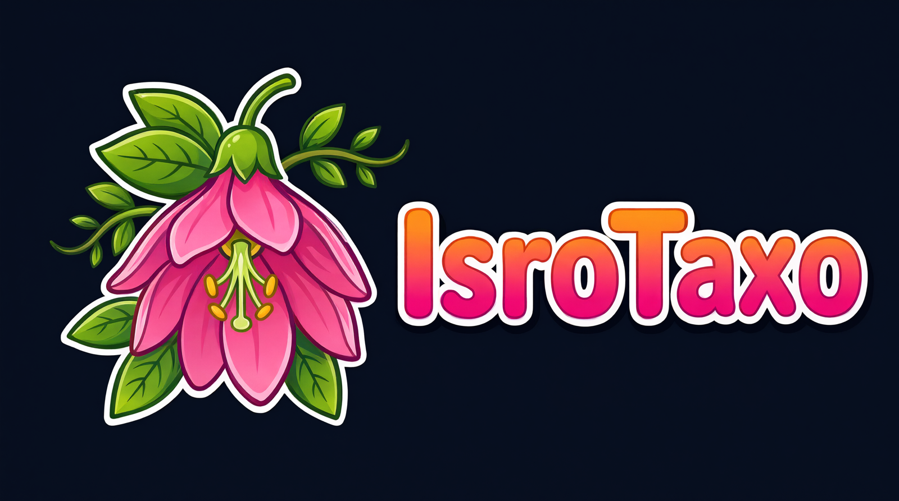
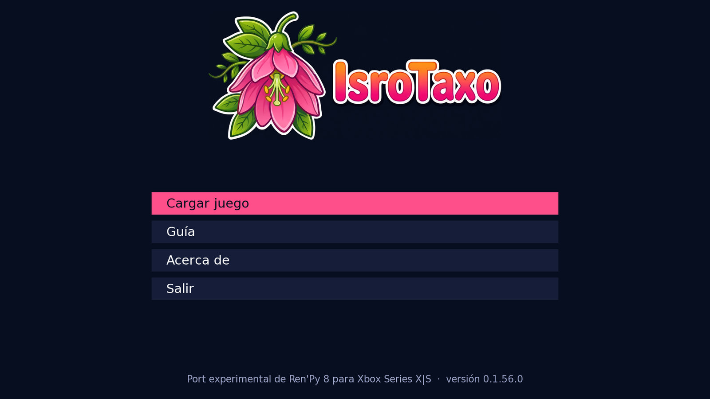
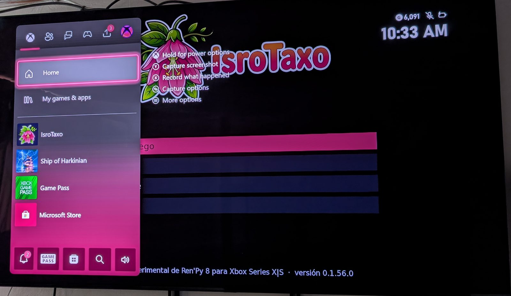
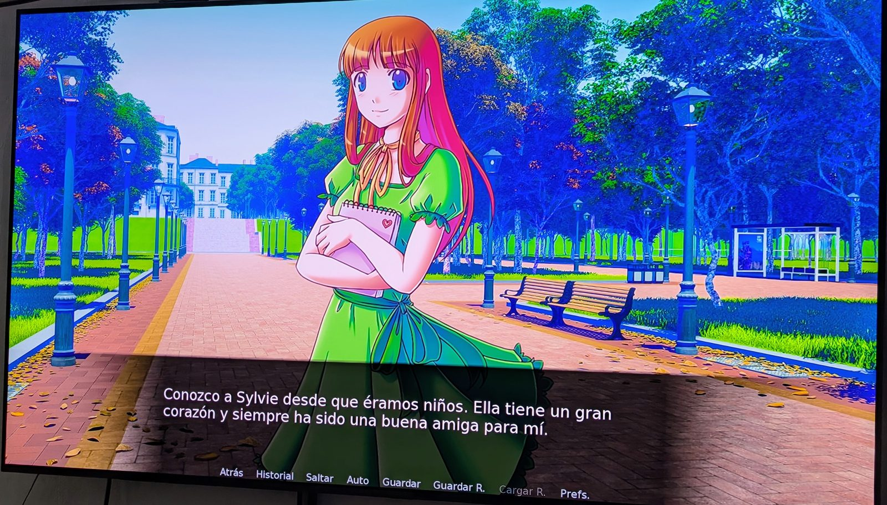
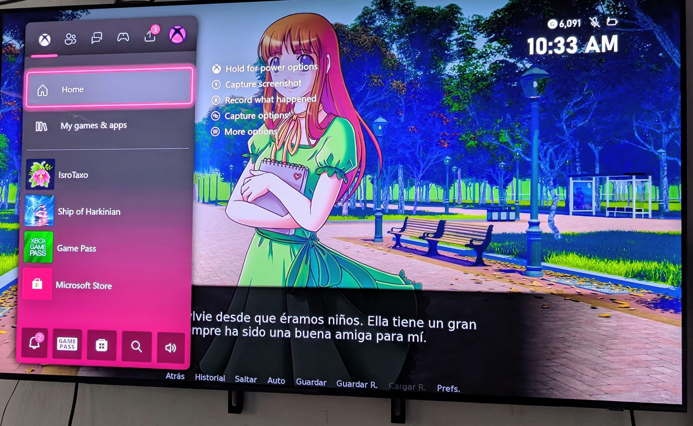

<p align="center"></p>

<p align="center"><b>English</b> · <a href="README.es.md">Español</a></p>

# IsroTaxo — experimental Ren'Py 8 port for Xbox Series X|S

**IsroTaxo** runs games made with **Ren'Py 8** **natively** on an Xbox Series X|S in **Developer Mode**
(Dev Mode). It is neither a web version nor an emulator. It is the Ren'Py 8.5 engine built for the console as a
UWP app:

- embedded Python 3.12 and Ren'Py's native modules;
- SDL2 for the window, the controller and audio;
- ANGLE for OpenGL ES on Direct3D 11;
- FFmpeg for audio and video.

First game tested end to end: *Katawa Shoujo: Re-Engineered*.

> **Status: experimental.** It works with the games tested so far, but may fail with others. This repository
> **does not include or accept games**: everyone brings their own.

## Download

Latest release: **[IsroTaxo_x64.msix](https://github.com/alexroses47/renpy-uwp/releases/latest/download/IsroTaxo_x64.msix)**
and its dependency **[Microsoft.VCLibs.x64.14.00.appx](https://github.com/alexroses47/renpy-uwp/releases/latest/download/Microsoft.VCLibs.x64.14.00.appx)**.
All versions, release notes and license texts: [Releases](../../releases).

## Screenshots

| IsroTaxo menu | With the Xbox guide open |
|---|---|
|  |  |

| *The Question* on the Xbox | With the Xbox guide open |
|---|---|
|  |  |

Photos of an Xbox Series S in Dev Mode connected to a TV (the game was set to Spanish). *The Question* is the
sample game of the Ren'Py SDK; its artwork is released under the same MIT license as Ren'Py (copyright of its
authors; see Ren'Py's license).

## What you need

- An **Xbox Series X|S in Developer Mode** (Dev Mode), with access to its Device Portal from your PC.
- A **USB drive formatted as NTFS** with the app permissions described in the guide below.
- The **PC (Windows or Linux) version** of a game made with **Ren'Py 8**.

## Install IsroTaxo

1. Download the two files above (`IsroTaxo_x64.msix` and `Microsoft.VCLibs.x64.14.00.appx`).
2. On your PC open the console's **Device Portal** (`https://<Xbox-IP>:11443`), go to
   **Home > My games & apps > Add**, choose the `.msix` and, in the dependencies step, add the VCLibs `.appx`.
3. On the console, in **Dev Home**, select **IsroTaxo**, press **View details** and set **App type: Game**.
   The console then gives it more memory, which larger games such as KS:RE need.
4. Open IsroTaxo. Its menu appears: **Load game**, **Guide**, **About**, **Language** and **Quit**. The menu
   follows the console language (English, or Spanish on Spanish consoles) and can be switched from the menu.

## Guide 1: prepare the USB drive (permissions)

Xbox apps can only read a USB drive that grants permissions to "all application packages".

**On Windows** (the most reliable method):

1. Format the drive as **NTFS**: right-click the drive > **Format** > File system **NTFS** > **Start**.
2. Right-click the drive > **Properties** > **Security** tab > **Advanced** > **Add** > **Select a principal** >
   **Advanced** > **Find Now**. Choose **ALL APPLICATION PACKAGES** > **OK**.
3. Tick **Full control** > **OK**. Tick **Replace all child object permission entries** > **OK**.
4. If an error about *System Volume Information* appears, ignore it and continue.
5. When you connect the drive to the Xbox, choose to use it **for media** (not for "games and apps").

Copy the games **after** setting the permissions. Files copied from Windows inherit the folder's permissions.

**On Linux:** files copied with `ntfs-3g` may end up **without** that permission even if the folder has it. The
sternserv community guide explains how to check and fix it with `getfattr`/`setfattr`:
[Copying games from Linux](https://wiki.sternserv.xyz/docs/xbox-setup/copying-games-from-linux).
If a game is on the drive but IsroTaxo does not see it or cannot open it, this is almost always the cause.

## Guide 2: add games

Copy the **`game`** folder of each game into `renpy\games\<game-name>\` on the USB drive:

```
E:\
└── renpy\
    └── games\
        ├── ksre\
        │   └── game\          ← the game's game folder (.rpa, .rpyc or .rpy files)
        └── another_game\
            └── game\
```

- The `game` folder is enough. You do **not** need the game's `renpy` or `lib` folders or its executables:
  IsroTaxo has its own Ren'Py 8.5.
- Games in `E:\renpy\games\` show up in **Load game** by themselves.
- If a game is somewhere else, use **Load game > Browse folders**. Navigate with the controller to the game's
  folder (the one that contains `game`, or `game` itself) and press **Load this folder**. If you pick a folder
  that is not a game, IsroTaxo shows you the expected layout.
- **Saves** are stored on the console (in the app's storage), not on the USB drive.
- Quitting a game brings you back to the IsroTaxo menu.

## Compatibility

| Game | Works? |
|---|---|
| Ren'Py **8.x** (regular `.rpa`, `.rpyc`, `.rpy` files) | Yes, in general. Tested: *The Question* (SDK sample) and *Katawa Shoujo: Re-Engineered*. |
| Ren'Py **7.x or older** (Python 2) | No. |
| Games using **Live2D**, their own native extensions (`.pyd`/`.dll`), `ctypes` or Steam features | No, or without those parts (e.g. no Steam achievements or Discord). |
| Games designed for the mouse only | They start, but playing them with a controller may be awkward. |

Current video output: the console's system mode (usually 1080p). 4K output is in development.

## For developers

Everything is built on GitHub Actions (`windows-2022`); development happens on Linux with `gh`.

```bash
gh workflow run build-host.yml && gh run watch
export XBOX_DP_USER=... XBOX_DP_PASS=...   # Device Portal credentials (never in the repository)
ci/deploy.sh                    # installs the latest build on the console
ci/set-game.sh ksre             # optional: open that game directly on the next start
ci/fetch-logs.sh                # downloads LocalState\renpy-uwp.log (and --file logs/<game>/log.txt)
ci/screenshot.sh                # saves what the console shows (Device Portal capture)
```

| Path | Contents |
|---|---|
| `host/` | UWP app (C++/WinRT host, the IsroTaxo menu in `host/RenpyUWP/menu`, Python launcher) |
| `deps/` | Native dependency recipes for UWP (SDL2 + patches, media libraries, FFmpeg, assimp, ANGLE) |
| `python/` | CPython 3.12 for UWP |
| `renpy/` | Pinned Ren'Py (`renpy/VERSION`), its patches and the static build of its modules |
| `ci/` | Deploy and logs from Linux, CI checks |
| `docs/` | `RESEARCH.md` (decisions and findings, in Spanish), `PROGRESS.md`, `SIGNING.md` |

The signing certificate is set up once (`docs/SIGNING.md`).

## Licenses

IsroTaxo's original code (host, menu, launcher, scripts and recipes) is under the **Mozilla Public License 2.0**
([`LICENSE`](LICENSE)). The MPL requires keeping the license and copyright notices in any redistribution or fork,
and publishing the source of modified files.

The **IsroTaxo name and logo** are not part of the code license (MPL-2.0 grants no trademark rights, §2.3). The
logo is the project author's artwork, all rights reserved. If you fork the project, please use your own name and
logo, and we would appreciate a note saying it is **based on IsroTaxo**, with a link to this repository.

Third-party components keep their licenses, and so do our patches to their files: Ren'Py (MIT), CPython (PSF),
SDL2, SDL2_image and zlib (zlib), libpng, libjpeg-turbo, libwebp, FreeType, HarfBuzz, assimp and ANGLE
(BSD/MIT/FTL), FriBidi and FFmpeg (LGPL-2.1, linked under §6(a)), SIL OFL fonts. Details in
[`THIRD_PARTY_NOTICES.md`](THIRD_PARTY_NOTICES.md); each release includes a `licenses/` folder.

Games are not part of the project and keep their own licenses (for example, *Katawa Shoujo: Re-Engineered*:
MPL-2.0 code and CC BY-NC-ND assets).

Ren'Py is the work of Tom Rothamel and contributors. Xbox is a trademark of Microsoft. IsroTaxo is not affiliated
with any of them.
